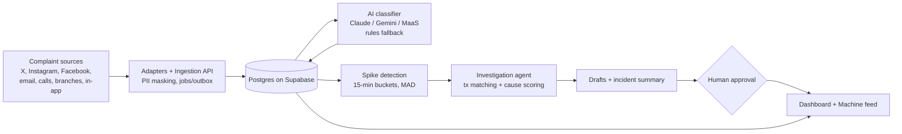

# Conflux HQ

**AI complaint intelligence for banks. Payment failures show up as customer complaints first — Conflux HQ catches them before they trend.**

Built for the **Access Youth Tech Forge Hackathon — Theme 1: Payments & Financial Infrastructure.**

> **Hackathon prototype. All data is synthetic.** No real bank, customer, or money-movement data is used. Demo login is `Zymic Bank / 123` (demo mode, not production auth). See [backend/README.md](backend/README.md) for the full API contract.

---

## Table of contents

- [The problem](#the-problem)
- [What Conflux HQ does](#what-conflux-hq-does)
- [2-minute demo](#2-minute-demo)
- [Architecture](#architecture)
- [Features](#features)
- [Tech stack](#tech-stack)
- [Repo structure](#repo-structure)
- [Quickstart](#quickstart)
- [Configuration](#configuration)
- [API overview](#api-overview)
- [Dashboard map](#dashboard-map)
- [AI design](#ai-design)
- [Security, fraud & privacy](#security-fraud--privacy)
- [Tests](#tests)
- [Roadmap](#roadmap)
- [Team](#team)

---

## The problem

When a payment system breaks, the first signal isn't a system alert — it's a flood of customer complaints scattered across X, Instagram, Facebook, email, call centres, branches, and in-app chat. Each channel has its own team, each complaint becomes its own ticket, and nobody sees the pattern until the failure is already public.

These are settlement and reconciliation failures: a debit with no credit, a failed ATM/POS debit that never reverses, a duplicate charge. The CBN received **23,129 customer complaints in 2025, up 10.53% from 2024**, ordering **₦19.12bn + $329.3m** refunded (CBN 2025 data via Leadership / Prime Business Africa).

## What Conflux HQ does

1. **Unifies** complaints from every channel into one feed (with PII masked on ingest).
2. **Classifies** each complaint — issue type, severity, sentiment, language — including Nigerian Pidgin ("my money don enter nowhere"), Yoruba, Hausa, Igbo.
3. **Detects spikes** deterministically (15-min buckets, median + MAD baseline) and opens ranked incidents.
4. **Investigates** the likely cause — transaction matching + release/outage evidence + bounded AI agent with confidence scores.
5. **Drafts** a customer holding message, an IT ticket, and a reversal request.
6. **Waits for a human** — nothing touching money executes without approval. Every step is audit-logged.
7. **Shows it** — agent / IT / management views, analytics, risk map, security queue, reconciliation, audit trail, and a Stripe-grade **Developer Portal** at `/developers`.

### Demo scenario

At 10:00 a simulated app release (v4.2.1) goes live. From ~10:12, failed-transfer complaints surge on USSD + app through one switch. Conflux HQ flags the spike, traces it to the release, drafts the response, and holds the reversal for a person to approve. A small unrelated fee cluster correctly does **not** trigger an alert, plus a scam cluster routes to the security queue.

---

## 2-minute demo

**1. Log in**

- Frontend: `http://localhost:3000/login`
- Username: `Zymic Bank` · Password: `123`

**2. Seed the synthetic universe** (`POST /api/v1/synthetic/seed`)

```json
{ "seed": 42, "at": "2026-11-06T10:14:59Z" }
```

Creates ~1,000 complaints, ~5,000 transactions, release v4.2.1 + a decoy maintenance event. Response returns `detection_at` and `release_at`.

**3. Detect the spike** (`POST /api/v1/incidents/detect`)

```json
{ "now": "<detection_at from seed>" }
```

Expect one `failed_transfer` incident with ~30 complaints.

**4. Investigate** — open the incident in the dashboard, or call:

```text
POST /api/v1/ai/incidents/{id}/investigate
POST /api/v1/jobs/drain   # drains classification / detection / investigation / outbox jobs
```

Then review drafts (`customer_message`, `it_ticket`, `reversal_request`), approve/reject, and check the audit trail.

Interactive API docs: `http://localhost:8000/docs`

---

## Architecture



Adapters keep the core bank-agnostic: the prototype plugs in a simulator + X API v2 adapter; a bank would plug in official social APIs, its complaint system, and transaction/incident logs without changing detection, the agent, or the dashboard.

---

## Features

- **Unified complaint feed** — filter by channel, issue, region, fraud, time; complaint detail view.
- **Multilingual AI classification** — issue, severity, sentiment, language, amounts, refs (Claude / Gemini / Forge MaaS, deterministic fallback offline; 100-item golden set + `/ai/evaluate`).
- **Deterministic spike detection** — per-issue baselines, ranked incidents with volume, growth, channels, priority score.
- **Bounded investigation agent** — tools: incident stats, transaction search, system events, baseline compare; grounded drafts, confidence shown, guardrails enforced.
- **Human approval + audit** — approve/reject drafts; reversal never auto-executes; full audit trail per incident.
- **Reconciliation** — match complaints to transactions, payment exceptions, proposals, summaries.
- **Security queue** — scam / account-takeover routing (`is_fraud=true`).
- **X (Twitter) intake** — v2 recent search / filtered stream, rule sync, recorded-replay fallback, $0.005/post spend cap.
- **Analytics** — totals, trends (zero-filled hourly UTC), breakdowns, transaction stats, time-to-detect, repeat-complaint rate.
- **Machine Handoff Feed** — `GET /api/v1/machine/updates` with scoped `cfx_api_` tokens for NOC/SIEM polling.
- **Developer Portal** — `/developers`: cURL/Python/JS snippets, Try-It sandbox, OpenAPI explorer.

---

## Tech stack

| Layer | Choice |
| --- | --- |
| Backend | Python, FastAPI, SQLAlchemy 2, Alembic, Pydantic v2 |
| Database | Supabase Postgres (Session pooler, RLS); SQLite for explicit offline/test |
| AI | Anthropic Claude, Google Gemini, Forge Huawei MaaS — with rules fallback |
| Frontend | Next.js 16, React 19, Tailwind CSS 4, Recharts, Framer Motion, lucide-react |
| Testing | pytest (isolated in-memory SQLite, fake Supabase) |

---

## Repo structure

```text
conflux-hq/
  PRD.md                 full product requirements + 72-hour plan
  .env.example            copy to .env (never commit .env)
  docker-compose.yml      optional local Postgres
  backend/
    app/
      main.py            FastAPI app + CORS
      api/routes/        health, auth, bank, ingestion, complaints, incidents,
                         remediation, analytics, ai, jobs, api_keys, social,
                         reconciliation, synthetic, forge_webhooks
      ai/                classifier, providers, investigation agent,
                         drafts, guardrails, eval, clustering, evidence
      adapters/          X v2 adapter, bank intake, webhook clients/schemas
      services/          auth, complaint, spike detection, transaction
                         matching, reconciliation, remediation, handoff feed,
                         social intake, worker, audit
      models/            banks, complaints, incidents, transactions,
                         system events, drafts, audit log, jobs, api keys,
                         payment exceptions/proposals, social, remediation
      core/              config, security, PII masking
      db/                engine/session, init
    alembic/             0001 schema, 0002 RLS
    tests/               auth, API, privacy, spike detection, AI
    scripts/             init_db
  frontend/
    app/
      page.tsx           landing
      login/             login + register
      dashboard/         overview, complaints, incidents, analytics,
                         risk-map, security, social, reconciliation,
                         audit, settings/keys
      developers/        API docs portal
    lib/                 backend client (api.ts), social, reconciliation types
    components/
  data/synthetic/        fixtures (seeded via API, not checked in)
```

---

## Quickstart

### Prerequisites

- Python 3.11+ · Node 20+ · Git
- A Supabase project (for Postgres), **or** explicit SQLite for offline

### 1. Backend

```bash
cd backend
python -m venv .venv
# Git Bash / Windows:
source .venv/Scripts/activate
# macOS / Linux: source .venv/bin/activate

pip install -r requirements.txt
cp ../.env.example ../.env   # then fill in values (see below)

alembic upgrade head
uvicorn app.main:app --reload --host 127.0.0.1 --port 8000
```

Open `http://localhost:8000/docs`.

> Offline only: set `DATABASE_URL=sqlite:///./conflux.db`. There is no silent fallback — SQLite must be explicit. Tests always use isolated in-memory SQLite.

### 2. Frontend

```bash
cd frontend
npm ci
npm run dev
```

Open `http://localhost:3000` → `/login` with `Zymic Bank / 123`.

### 3. Replay the scenario

See [2-minute demo](#2-minute-demo) above. Full endpoint reference lives in [backend/README.md](backend/README.md) — analytics windows use `hours` (1–720) + timezone-aware `at`; for the full seeded set use `hours=49&at=<detection_at>`.

---

## Configuration

Copy `.env.example` → `.env`. Key variables:

| Variable | Purpose |
| --- | --- |
| `DATABASE_URL` | Supabase **Session pooler** string (`sslmode=require`), or explicit `sqlite:///./conflux.db` offline |
| `DEMO_MODE` | `true` = hackathon login (`Zymic Bank / 123`); `false` = Supabase Auth mode. Never `true` in production |
| `DEMO_TOKEN_SECRET` | **Required.** Random ≥32 chars: `python -c "import secrets; print(secrets.token_urlsafe(48))"` |
| `DEMO_TOKEN_MINUTES` | Token TTL (default 120) |
| `AI_PROVIDER` | `anthropic` / `gemini` / `maas`; empty keys = deterministic fallback |
| `ANTHROPIC_API_KEY`, `ANTHROPIC_MODEL` | Claude classification/agent/drafts |
| `GEMINI_API_KEY`, `GEMINI_MODEL` | Gemini alternative |
| `MAAS_ENABLED`, `MAAS_BASE_URL`, `GATEWAY_KEY` | Forge cluster-internal MaaS (injected at runtime, never committed) |
| `X_BEARER_TOKEN` | X API v2 App-Only token; unset = recorded-replay mode |
| `X_DAILY_POST_LIMIT` | Spend guardrail (default 500 posts/day ≈ $2.50) |
| `SUPABASE_URL`, `SUPABASE_ANON_KEY`, `SUPABASE_SERVICE_ROLE_KEY` | Future Auth mode (`DEMO_MODE=false`); service key stays server-side |
| `SPIKE_*` | Bucket size, baseline window, MAD sensitivity, min volume |

---

## API overview

All paths prefixed `/api/v1`. Send `Authorization: Bearer <access_token>` except health/login.

| Area | Endpoints |
| --- | --- |
| Health/Auth | `GET /health` · `POST /auth/login` (`{"username":"Zymic Bank","password":"123"}`) · `GET /auth/me` |
| Complaints | `GET /complaints` (channel/issue/region/fraud/since/until/limit/offset) · `GET /complaints/{id}` · `POST /complaints`, `/bulk` · `PATCH /complaints/{id}/classification` · `POST /complaints/{id}/classify` |
| Incidents | `POST /incidents/detect` · `GET /incidents` · `GET /incidents/{id}` |
| AI | `POST /ai/classify` · `POST /ai/incidents/{id}/investigate` · `GET /ai/incidents/{id}/drafts` · `POST /ai/drafts/{id}/decision` · `GET /ai/incidents/{id}/audit` · `GET /ai/evaluate` |
| Analytics | `GET /analytics/summary` · `/trends` · `/breakdown` · `/transactions` |
| Synthetic | `POST /synthetic/seed` · `GET /synthetic/transactions` · `GET /synthetic/system-events` |
| Social (X) | `GET /social/x/status` · `POST /social/x/sync-rules` · `POST /social/x/pull` · `POST /social/x/ingest-raw` · `POST /social/x/replay` |
| Ops | `GET /jobs` · `POST /jobs/drain` · machine feed · API keys · reconciliation · remediation · ingestion |

`DEMO_MODE=false` restores Supabase Auth register/login/refresh + staff endpoints (restart required; route selection happens at import).

---

## Dashboard map

| Route | What judges should open |
| --- | --- |
| `/` | Landing |
| `/login` | Demo login + bank registration |
| `/dashboard` | Overview: incidents, feed, KPIs |
| `/dashboard/complaints` | Filterable feed + detail (`/complaints/[id]`) |
| `/dashboard/incidents` | Ranked incidents + detail, investigate, drafts, approvals |
| `/dashboard/analytics` | Trends, root causes, channels, time-to-detect |
| `/dashboard/risk-map` | Geographic/segment exposure |
| `/dashboard/security` | Fraud/scam queue |
| `/dashboard/social` | X intake status, rules, replay |
| `/dashboard/reconciliation` | Exceptions, proposals, summaries |
| `/dashboard/audit` | Agent steps + human decisions |
| `/dashboard/settings/keys` | Machine `cfx_api_` tokens |
| `/developers` | Docs, snippets, Try-It, OpenAPI |

---

## AI design

- **Classifier:** Claude/Gemini/MaaS with strict validated JSON; multilingual incl. Pidgin; deterministic rules fallback when keys are empty.
- **Investigation agent:** bounded tool-use loop (incident stats → transaction search → system events → baseline compare → draft), cause ranking with confidence, grounded drafts that cite only data-present facts.
- **Guardrails:** agent proposes, never executes money movement; low confidence is displayed, not hidden; every step audit-logged.
- **Spike detection (deterministic):** per issue type, baseline = median of trailing 15-min buckets; flag when current > baseline + 3× scaled MAD with ≥10 complaints.
- **Priority score:** volume + growth + reported money exposure, normalised 0–100. Money figures are unverified complaint-reported exposure, not confirmed loss.

---

## Security, fraud & privacy

- **Bank isolation:** every table carries `bank_id`; queries are tenant-scoped; RLS enabled.
- **PII masking:** phones, account numbers, emails, cards masked before storage; customer refs one-way hashed (NDPR-aligned).
- **Human approval** for all money actions + full audit log.
- **Fraud routing** to the security queue.
- **Secrets in `.env` only** — never commit; service-role keys never reach the browser. Demo creds are shared/public by design — keep demos local or access-restricted (no rate limiter); `DEMO_MODE` is rejected in production.

---

## Tests

```bash
cd backend
pytest -q
```

Covers demo auth/token checks, synthetic seeding, analytics windows + bank isolation, transaction links, repeat detection, and the retained Supabase Auth workflow (fake provider). No live Supabase or AI keys needed.

---

## Roadmap

**Built** — auth + roles, multi-tenant model + RLS, ingestion with masking, spike detection + incidents, AI classifier + agent + drafts + approvals, analytics, X intake, reconciliation, machine feed, developer portal, dashboard.

**After the hackathon** — live bank/switch/social integrations via adapters, settlement + reconciliation data, approved low-risk auto-resolution, SSO/MFA + production security review.

**Business model** — subscription by channels + complaint volume; fraud routing and reconciliation insights as add-ons; expand banks → fintechs/telcos/mobile-money → more African markets and languages.

---

## Team

| Name | Role |
| --- | --- |
| Alegbeleye Opeyemi | Backend |
| Adakole Andrew | Frontend & Product Design |
| David Uwagbale | System Architecture & Data |
| Adekola Folarin John | AI Engineer |

Young Nigerian students building for the customers banks serve.

---

## Further reading

- [PRD.md](PRD.md) — full requirements, AI design, dashboard spec, 72-hour plan
- [backend/README.md](backend/README.md) — demo setup + complete API reference
