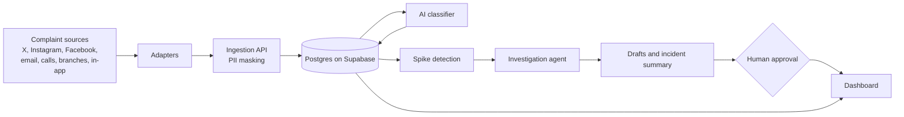

# Conflux HQ

**AI complaint intelligence for banks. Payment failures show up as customer complaints first. Conflux HQ catches them before they trend.**

Built for the Access Youth Tech Forge hackathon, Theme 1: Payments and Financial Infrastructure.

> **Status: hackathon prototype.** The backend now includes a demo-only **Zymic Bank / 123** login, Supabase Postgres configuration, complaint ingestion, spike detection, analytics and synthetic-data routes. Dashboard, AI classification, investigation and approvals are not implemented. All prototype data is synthetic; no real bank or customer data is used.
>
> **Current demo setup and API contract:** [backend/README.md](backend/README.md). Demo login is separate from Supabase Auth; supply a Supabase database connection and a random demo token secret. Registration and staff administration are hidden in demo mode. The older Supabase Auth workflow below is available only with `DEMO_MODE=false`.

---

## The problem

When a payment system breaks, the first signal is a flood of customer complaints scattered across X, Instagram, Facebook, email, call centres, branches and in-app chat. Each channel has its own team and each complaint becomes its own ticket. Nobody sees the pattern until the problem is already public.

These are settlement and reconciliation failures: a debit with no credit, a failed ATM or POS debit that never reverses, a duplicate charge. The first alarm is a complaint, not a system alert.

The scale is real. The CBN received 23,129 customer complaints in 2025, up 10.53% from 20,925 in 2024, and ordered ₦19.12bn and $329.3m refunded (CBN 2025 data as reported by Leadership and Prime Business Africa).

## What Conflux HQ does

1. **Unifies** complaints from every channel into one feed.
2. **Classifies** each one by issue type, severity, sentiment and language, including Nigerian Pidgin ("my money don enter nowhere").
3. **Detects spikes** when one issue type rises faster than normal, separating isolated incidents from systemic faults.
4. **Investigates** the likely cause by matching complaints to transactions and checking release and outage logs.
5. **Drafts** a customer holding message and an IT ticket.
6. **Waits for a human** to approve anything that touches money. Every step is logged.
7. **Shows analytics** on trends, root causes, channels and time to detect, with views for agents, IT and management.

### The demo scenario

At 10:00 a simulated app release (v4.2.1) goes live. From about 10:12, failed-transfer complaints surge on USSD and the app through one switch. Conflux HQ flags the spike, traces it to the release, drafts the customer message and IT ticket, and holds the reversal for a person to approve. A small unrelated cluster of complaints correctly does not trigger an alert.

## Architecture



The data layer uses adapters. The prototype plugs in a simulator; a bank would plug in official social media APIs, its complaint system and its transaction and incident logs without changing detection, the agent or the dashboard.

## Tech stack

| Layer | Choice |
| --- | --- |
| Backend | Python, FastAPI, SQLAlchemy 2, Alembic |
| Database and auth | Supabase (Postgres and Auth) |
| AI | Claude API (classification, extraction, agent, drafts) |
| Frontend | React, Tailwind, Recharts (in progress) |

## Project structure

```
conflux-hq/
  PRD.md              full product requirements
  docker-compose.yml  local Postgres (optional)
  .env.example        copy to .env
  backend/
    alembic/          migrations: 0001 schema, 0002 row level security
    app/
      core/           config, JWT verification, PII masking
      db/             engine and session
      models/         banks, profiles, complaints, transactions,
                      system events, incidents, drafts, audit log
      schemas/        request and response models
      api/            auth and role dependencies, routes
      services/       auth, Supabase client, complaints, spike detection, audit
      ai/             classifier and investigation agent (in progress)
    tests/            pytest suite
  frontend/           dashboard (in progress)
  data/synthetic/     generated demo data (in progress)
  docs/
```

## Getting started

### 1. Supabase

1. Create a project at [supabase.com](https://supabase.com).
2. **Project Settings > API:** copy the project URL, `anon` key and `service_role` key. If the page shows a legacy JWT secret, copy it too; otherwise leave it empty.
3. **Project Settings > Database > Connection string:** copy the **Session pooler** string.
4. **Authentication > Providers > Email:** choose whether to require email confirmation. **Authentication > URL Configuration:** set the Site URL to your frontend.

### 2. Run the backend

```bash
cd backend
python -m venv .venv && source .venv/bin/activate
pip install -r requirements.txt
cp ../.env.example ../.env      # then fill in your values
alembic upgrade head
uvicorn app.main:app --reload
```

Open http://localhost:8000/docs for interactive API docs.

To try it without Supabase, explicitly set `DATABASE_URL=sqlite:///./conflux.db`. Demo login needs `DEMO_TOKEN_SECRET`, not Supabase Auth keys; the retained non-demo auth endpoints need Supabase keys. See [backend/README.md](backend/README.md) for the current demo instructions. The test suite needs neither live service.

### 3. Run the tests

```bash
cd backend
pytest
```

The tests use a fake Supabase, so no keys are needed. They cover registration, login, roles, bank isolation, PII masking and spike detection.

## Configuration

| Variable | Purpose |
| --- | --- |
| `DATABASE_URL` | SQLite for quick tests, or the Supabase Session pooler string |
| `SUPABASE_URL`, `SUPABASE_ANON_KEY` | Supabase project and public key |
| `SUPABASE_SERVICE_ROLE_KEY` | Server-side only: staff invites and rollbacks. Never expose it to the browser |
| `SUPABASE_JWT_SECRET` | Only for projects on the legacy shared secret |
| `SITE_URL` | Where invite emails send people |
| `ANTHROPIC_API_KEY`, `ANTHROPIC_MODEL` | AI features |
| `SPIKE_*` | Bucket size, baseline window, sensitivity and minimum volume |

## API overview

| Endpoint | Who | What |
| --- | --- | --- |
| `POST /api/v1/auth/register` | public | Register a bank and its first admin |
| `POST /api/v1/auth/login` | public | Email and password; returns tokens and profile |
| `POST /api/v1/auth/refresh` | public | Exchange a refresh token |
| `GET /api/v1/auth/me` | any member | Current user and bank |
| `GET, PATCH /api/v1/bank` | member, admin | View or edit the bank profile |
| `GET, POST /api/v1/bank/members` | admin (manager can list) | List or invite staff |
| `PATCH /api/v1/bank/members/{id}` | admin | Change role or disable |
| `POST /api/v1/complaints`, `/bulk` | admin, agent, IT | Ingest complaints (PII is masked first) |
| `GET /api/v1/complaints` | any member | Filter by channel, issue, time |
| `PATCH /api/v1/complaints/{id}/classification` | admin, agent, IT | AI classifier writes results |
| `POST /api/v1/incidents/detect` | admin, agent, IT | Run spike detection (optionally at a simulated time) |
| `GET /api/v1/incidents` | any member | Ranked incidents |
| `GET /api/v1/analytics/summary` | any member | Counts by issue type and channel |

Send `Authorization: Bearer <access_token>` on every protected call.

## Roles

| Role | Can do |
| --- | --- |
| `bank_admin` | Everything, including managing staff and the bank profile |
| `agent` | Read and write complaints and incidents |
| `it` | Read and write complaints and incidents |
| `manager` | Read-only analytics |

## Security, fraud and privacy

- **Bank isolation:** every table carries `bank_id`, and every query is filtered by the signed-in user's bank.
- **Row level security** is enabled on every table, so Supabase's own REST API exposes nothing.
- **PII masking:** phone numbers, account numbers, emails and card numbers are masked before storage. Customer references are one-way hashed (NDPR alignment).
- **Human approval** for every money action, with a full audit log of agent steps and human decisions.
- **Fraud routing:** scam and account-takeover complaints are routed to a security queue.
- **Secrets** live in `.env` only. Never commit it.

## Roadmap

**Built**
- Bank registration, login, roles and staff invites
- Multi-tenant data model with migrations and row level security
- Complaint ingestion with PII masking
- Deterministic spike detection with incident creation and audit logging
- Analytics summary endpoint

**In progress**
- Synthetic data generator with the planted v4.2.1 scenario
- AI classifier and investigation agent
- Draft and approval endpoints
- Transaction matching
- Dashboard

**After the hackathon**
- Live social media and bank integrations through the adapter layer
- Settlement and reconciliation data
- Approved low-risk auto-resolution
- Production security review, SSO and multi-factor authentication

## Business model

Banks pay a subscription based on channels connected and complaint volume. Fraud routing and reconciliation insights are paid add-ons. Growth path: more banks, then fintechs, telcos and mobile money operators, then more African markets and local languages.

## Team

| Name | Role |
| --- | --- |
| Alegbeleye Opeyemi | Backend |
| Adakole Andrew | Frontend and Product Design |
| David Uwagbale | System Architecture and Data |
| Adekola Folarin John | AI Engineer |

Young Nigerian students building for the customers banks serve.

## Further reading

- [PRD.md](PRD.md): full requirements, AI design, dashboard spec and the 72-hour plan